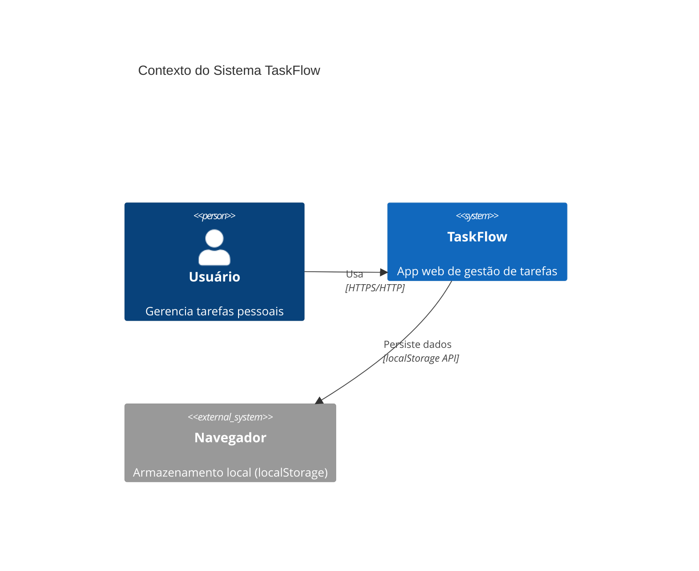
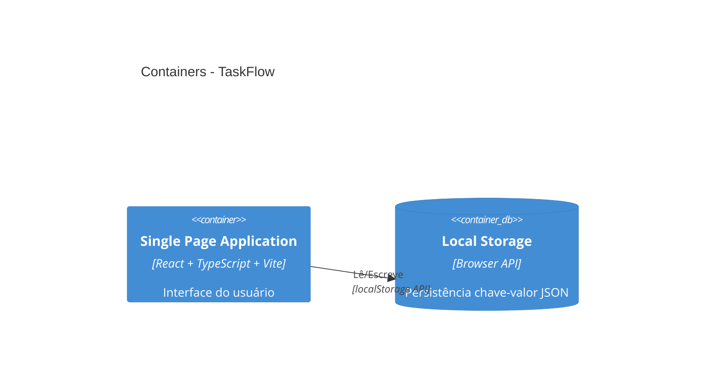

# TaskFlow - Documentação Técnica Completa

> **Aplicação web full-stack para gerenciamento de tarefas pessoais**  
> Stack: React 18 + TypeScript + Vite + Tailwind CSS + Zustand

---

## 📋 Sumário

1. [Visão Geral](#visão-geral)
2. [Arquitetura do Sistema](#arquitetura-do-sistema)
3. [Modelo de Dados](#modelo-de-dados)
4. [Gerenciamento de Estado](#gerenciamento-de-estado)
5. [Estrutura de Pastas](#estrutura-de-pastas)
6. [Funcionalidades Implementadas](#funcionalidades-implementadas)
7. [Interface do Usuário](#interface-do-usuário)
8. [Validação e Tipagem](#validação-e-tipagem)
9. [Temas e Acessibilidade](#temas-e-acessibilidade)
10. [Configuração de Build e Deploy](#configuração-de-build-e-deploy)
11. [Testes e Qualidade](#testes-e-qualidade)
12. [Processo de Desenvolvimento](#processo-de-desenvolvimento)

---

## 🎯 Visão Geral

### Propósito
TaskFlow é uma aplicação web **single-page** (SPA) para gerenciamento de tarefas pessoais, focada em **simplicidade, usabilidade e produtividade**. Não requer backend — todos os dados persistem no `localStorage` do navegador.

### Público-Alvo
Usuários individuais que buscam uma ferramenta leve, rápida e eficiente para organização pessoal.

### Principais Características

| Categoria | Funcionalidades |
|-----------|-----------------|
| **Tarefas** | CRUD completo, status (pendente/concluída), prioridades (4 níveis), datas de vencimento, descrição |
| **Projetos** | Organização hierárquica com cores e ícones (Lucide), projeto padrão imutável |
| **Tags** | Tags personalizadas coloridas, associação múltipla por tarefa |
| **Dashboard** | Estatísticas em tempo real, gráficos de distribuição, tarefas recentes, prazos próximos |
| **Filtros** | Busca textual, status, prioridade, projeto, ordenação (4 critérios) |
| **Tema** | Claro / Escuro / Sistema (detecção automática) |
| **Dados** | Persistência localStorage, Import/Export JSON |
| **Acessibilidade** | WCAG 2.1 AA, navegação por teclado, ARIA labels |

---

## 🏗️ Arquitetura do Sistema

### Diagrama de Contexto (C4 - Nível 1)



### Diagrama de Containers (C4 - Nível 2)



### Princípios Arquiteturais

1. **Feature-Based Architecture** — Organização por domínio (tasks, projects, tags) ao invés de tipo técnico
2. **Unidirectional Data Flow** — Zustand com middleware `persist` para sincronização automática
3. **Type-First Development** — TypeScript strict mode, Zod para validação runtime + inferência de tipos
4. **Component Composition** — Shared UI components + feature-specific components
5. **Mobile-First Responsive** — Breakpoints: <640px (mobile), 640-1024px (tablet), >1024px (desktop)

---

## 📊 Modelo de Dados

### Types Centrais (`src/shared/types/index.ts`)

```typescript
// Tipos base
export type Priority = "low" | "medium" | "high" | "urgent";
export type TaskStatus = "pending" | "completed";
export type Theme = "light" | "dark" | "system";

// Entidades
export interface Tag {
  id: string;
  name: string;
  color: string; // hex #RRGGBB
}

export interface Project {
  id: string;
  name: string;
  color: string; // hex #RRGGBB
  icon: string;  // nome do ícone Lucide
  createdAt: string; // ISO 8601
}

export interface Task {
  id: string;
  title: string;
  description: string;
  status: TaskStatus;
  priority: Priority;
  projectId: string | null;
  tagIds: string[];
  dueDate: string | null; // ISO 8601 date only (YYYY-MM-DD)
  createdAt: string; // ISO 8601
  updatedAt: string; // ISO 8601
  completedAt: string | null; // ISO 8601
}

// Estado global agregado
export interface AppState {
  tasks: Task[];
  projects: Project[];
  tags: Tag[];
  theme: Theme;
}
```

### Regras de Negócio

| Entidade | Regras |
|----------|--------|
| **Task** | Título obrigatório (1-100 chars), descrição opcional (max 500), prioridade obrigatória, dueDate opcional |
| **Project** | Nome obrigatório (1-50 chars), cor hex válida, ícone Lucide obrigatório, projeto "default" imutável |
| **Tag** | Nome obrigatório (1-30 chars), cor hex válida |
| **Persistência** | 3 stores independentes (tasks, projects, tags) com versionamento |

---

## 🔄 Gerenciamento de Estado

### Padrão: Zustand + Persist Middleware

Cada feature possui seu próprio store isolado com persistência automática:

```typescript
// Exemplo: taskStore.ts
export const useTaskStore = create<TaskState>()(
  persist(
    (set, get) => ({
      tasks: [],
      filter: defaultFilter,
      // ... actions
    }),
    {
      name: "taskflow-tasks",        // chave no localStorage
      storage: createJSONStorage(() => localStorage),
      version: 1,                    // para migrações futuras
    }
  )
);
```

### Stores Implementados

| Store | Arquivo | Chave localStorage | Estado Gerenciado |
|-------|---------|-------------------|-------------------|
| **Tasks** | `features/tasks/store/taskStore.ts` | `taskflow-tasks` | tasks[], filter{}, stats, CRUD |
| **Projects** | `features/projects/store/projectStore.ts` | `taskflow-projects` | projects[], CRUD (default protegido) |
| **Tags** | `features/tags/store/tagStore.ts` | `taskflow-tags` | tags[], CRUD, defaults pré-definidos |
| **Theme** | `app/providers/ThemeProvider.tsx` | `taskflow-theme` | theme, resolvedTheme |

### Seletores Otimizados

```typescript
// No componente - apenas reassina quando o estado relevante muda
const tasks = useTaskStore((state) => state.getFilteredTasks());
const stats = useTaskStore((state) => state.getTaskStats());
const { theme, setTheme } = useTheme();
```

### Fluxo de Dados Unidirecional

```
┌─────────────┐     ┌──────────────┐     ┌─────────────┐     ┌──────────────────┐
│ User Action │────▶│  Component   │────▶│ Hook/Action │────▶│ Store (Zustand)  │
└─────────────┘     └──────────────┘     └─────────────┘     └────────┬─────────┘
                                                                      │
                                                                      ▼
┌─────────────┐     ┌──────────────┐     ┌─────────────┐     ┌──────────────────┐
│   Re-render │◀────│  Component   │◀────│  Subscribe  │◀────│ State Change     │
└─────────────┘     └──────────────┘     └─────────────┘     └──────────────────┘
                                                                      │
                                                                      ▼
                                                              ┌──────────────────┐
                                                              │ Persist Middle   │
                                                              │ localStorage     │
                                                              └──────────────────┘
```

---

## 📁 Estrutura de Pastas

```
taskflow/
├── public/                      # Assets estáticos
├── specs/                       # Especificações (Markdown)
│   ├── 01-visao-geral.md
│   ├── 02-requisitos-funcionais.md
│   ├── 03-requisitos-nao-funcionais.md
│   ├── 04-arquitetura.md
│   ├── 05-processo-desenvolvimento.md
│   └── 06-deploy.md
├── src/
│   ├── app/                     # Configuração da aplicação
│   │   ├── providers/           # Providers React (Theme, Store, Router)
│   │   │   ├── ThemeProvider.tsx
│   │   │   └── StoreProvider.tsx
│   │   └── routes/              # Definição de rotas
│   │
│   ├── features/                # FEATURE-BASED: domínio por funcionalidade
│   │   ├── tasks/               # Feature: Tarefas
│   │   │   ├── components/      # TaskList, TaskItem, TaskForm, TaskFilters
│   │   │   ├── hooks/           # Hooks específicos da feature
│   │   │   ├── store/           # taskStore.ts (Zustand slice)
│   │   │   ├── types/           # Types específicos (se necessário)
│   │   │   └── utils/           # Utils específicos
│   │   │
│   │   ├── projects/            # Feature: Projetos
│   │   │   ├── components/      # ProjectForm, ProjectList
│   │   │   ├── store/           # projectStore.ts
│   │   │   └── ...
│   │   │
│   │   └── tags/                # Feature: Tags
│   │       ├── components/      # TagForm, TagList
│   │       └── store/           # tagStore.ts
│   │
│   ├── pages/                   # Páginas da aplicação (roteamento)
│   │   ├── Dashboard.tsx        # Estatísticas, gráficos, visão geral
│   │   ├── Tasks.tsx            # Lista + filtros + FAB nova tarefa
│   │   ├── Projects.tsx         # Grid de projetos + formulário
│   │   ├── Tags.tsx             # Lista de tags + formulário
│   │   └── Settings.tsx         # Tema, Import/Export, configurações
│   │
│   ├── shared/                  # Código compartilhado entre features
│   │   ├── components/          # UI Components genéricos
│   │   │   ├── Button.tsx/.test.tsx
│   │   │   ├── Card.tsx
│   │   │   ├── Input.tsx
│   │   │   ├── Select.tsx
│   │   │   ├── Textarea.tsx
│   │   │   ├── Modal.tsx
│   │   │   └── Toast.tsx
│   │   ├── hooks/               # Hooks genéricos
│   │   │   └── useLocalStorage.ts  # useLocalStorage, useDebounce, useMediaQuery
│   │   ├── utils/               # Utilitários gerais
│   │   │   ├── date.ts/.test.ts     # Formatação, validação de datas
│   │   │   ├── validation.ts        # Zod schemas + tipos inferidos
│   │   │   └── constants.ts         # PRIORITY_OPTIONS, STATUS_OPTIONS, etc.
│   │   └── types/               # Types globais (index.ts)
│   │
│   ├── styles/                  # Estilos globais
│   │   └── globals.css          # Tailwind directives + CSS variables
│   │
│   ├── test/                    # Configuração de testes
│   │   └── setup.ts             # Vitest setup (jest-dom, etc.)
│   │
│   ├── App.tsx                  # Componente raiz + layout (sidebar, header)
│   └── main.tsx                 # Entry point + providers
│
├── docs/                        # Documentação e screenshots
├── index.html                   # HTML template
├── package.json
├── tsconfig.json / tsconfig.node.json
├── vite.config.ts
├── tailwind.config.js
├── vercel.json
└── README.md
```

---

## ⚙️ Funcionalidades Implementadas

### RF-01: Gerenciamento de Tarefas
- ✅ **Criar** — Modal com validação Zod (título, descrição, prioridade, projeto, tags, data)
- ✅ **Editar** — Pré-popula formulário com dados existentes
- ✅ **Excluir** — Confirmação via toast, remoção imediata
- ✅ **Toggle Status** — Pendente ↔ Concluída (atualiza `completedAt`)
- ✅ **Listar com Filtros** — Status, prioridade, projeto, tags, busca textual
- ✅ **Ordenação** — Criadas, Vencimento, Prioridade, Alfabética (asc/desc)

### RF-02: Gerenciamento de Projetos
- ✅ **Criar** — Nome, cor (color picker), ícone (seletor Lucide)
- ✅ **Editar** — Exceto projeto "default" (protegido)
- ✅ **Excluir** — Move tarefas para "Sem projeto", exceto "default"
- ✅ **Listar** — Grid responsivo com contagem de tarefas

### RF-03: Tags
- ✅ **Criar** — Nome + cor
- ✅ **Associar/Desassociar** — Múltiplas tags por tarefa
- ✅ **Filtrar** — Select múltiplo no TaskFilters
- ✅ **Defaults** — 4 tags pré-definidas (Trabalho, Pessoal, Urgente, Estudos)

### RF-04: Dashboard e Estatísticas
- ✅ **Cards de Resumo** — Total, Pendentes, Concluídas, Atrasadas
- ✅ **Tarefas Recentes** — 5 mais recentes pendentes
- ✅ **Próximos Prazos** — Hoje, Esta semana, Atrasadas
- ✅ **Distribuição por Prioridade** — Barras de progresso animadas
- ✅ **Distribuição por Projeto** — Top 5 projetos com tarefas

### RF-05: Persistência e Configurações
- ✅ **localStorage** — 3 stores independentes + theme
- ✅ **Import/Export** — JSON completo do estado (Settings page)
- ✅ **Tema** — Light/Dark/System com detecção `prefers-color-scheme`
- ✅ **Notificações** — Toast system para feedback de ações

---

## 🎨 Interface do Usuário

### Layout Principal (`App.tsx`)

```
┌─────────────────────────────────────────────────────────────┐
│  Header (mobile only)  ☰  TaskFlow                          │
├─────────────┬───────────────────────────────────────────────┤
│             │                                               │
│  Sidebar    │              Main Content                     │
│  (fixed     │              (routes)                         │
│   desktop)  │                                               │
│             │  ┌─────────────────────────────────────────┐  │
│  • Dashboard│  │                                         │  │
│  • Tarefas  │  │         Page Content                    │  │
│  • Projetos │  │                                         │  │
│  • Tags     │  │                                         │  │
│  • Settings │  │                                         │  │
│             │  └─────────────────────────────────────────┘  │
│  Theme Toggle                                           FAB  │
└─────────────┴───────────────────────────────────────────────┘
```

### Breakpoints Responsivos

| Dispositivo | Largura | Sidebar | Grid Dashboard | FAB |
|-------------|---------|---------|----------------|-----|
| **Mobile** | < 640px | Colapsável (hamburger) | 1 coluna | Fixado bottom-right |
| **Tablet** | 640-1024px | Fixa (w-64) | 2 colunas | Fixado bottom-right |
| **Desktop** | > 1024px | Fixa (w-64) | 3-4 colunas | Fixado bottom-right |

### Componentes UI Compartilhados (`shared/components/`)

| Componente | Props Principais | Variantes |
|------------|-----------------|-----------|
| **Button** | `variant`, `size`, `onClick`, `disabled` | `primary`, `secondary`, `ghost`, `danger` / `sm`, `md`, `lg` |
| **Input** | `value`, `onChange`, `placeholder`, `error` | — |
| **Select** | `value`, `onChange`, `options[]` | — |
| **Textarea** | `value`, `onChange`, `rows` | — |
| **Modal** | `isOpen`, `onClose`, `title`, `children` | Backdrop click to close, ESC to close |
| **Card** | `children`, `className` | Container com sombra/borda |
| **Toast** | Provider + `useToast()` hook | `success`, `error`, `info` (auto-dismiss 3s) |

### Ícones (Lucide React)
- **Navegação**: LayoutDashboard, CheckSquare, FolderKanban, Tag, Settings
- **Ações**: Plus, Edit, Trash2, CheckCircle2, Circle, X, ChevronDown
- **Status**: AlertTriangle, Clock, TrendingUp, Target, Search, Filter
- **Tema**: Sun, Moon

---

## ✅ Validação e Tipagem

### Zod Schemas (`shared/utils/validation.ts`)

```typescript
// Task - validação completa de formulário
export const taskSchema = z.object({
  title: z.string().min(1, "Título é obrigatório").max(100, "Título muito longo"),
  description: z.string().max(500, "Descrição muito longa").optional(),
  priority: z.enum(["low", "medium", "high", "urgent"]),
  projectId: z.string().nullable(),
  tagIds: z.array(z.string()).default([]),
  dueDate: z.string().nullable().optional(),
});

// Project
export const projectSchema = z.object({
  name: z.string().min(1, "Nome é obrigatório").max(50, "Nome muito longo"),
  color: z.string().regex(/^#[0-9A-Fa-f]{6}$/, "Cor inválida"),
  icon: z.string().min(1, "Ícone é obrigatório"),
});

// Tag
export const tagSchema = z.object({
  name: z.string().min(1, "Nome é obrigatório").max(30, "Nome muito longo"),
  color: z.string().regex(/^#[0-9A-Fa-f]{6}$/, "Cor inválida"),
});

// Inferência automática de tipos TypeScript
export type TaskFormData = z.infer<typeof taskSchema>;
export type ProjectFormData = z.infer<typeof projectSchema>;
export type TagFormData = z.infer<typeof tagSchema>;
```

### TypeScript Strict Mode

```json
// tsconfig.json - configurações rigorosas
{
  "compilerOptions": {
    "strict": true,
    "noUncheckedIndexedAccess": true,
    "exactOptionalPropertyTypes": true,
    "noImplicitReturns": true,
    "noFallthroughCasesInSwitch": true,
    "forceConsistentCasingInFileNames": true
  }
}
```

---

## 🌙 Temas e Acessibilidade

### ThemeProvider (`app/providers/ThemeProvider.tsx`)

```typescript
// 3 modos suportados
type Theme = "light" | "dark" | "system";

// Detecção automática do sistema
const prefersDark = useMediaQuery("(prefers-color-scheme: dark)");

// Aplicação no documentElement
document.documentElement.classList.toggle("dark", resolved === "dark");
```

### Tailwind Dark Mode (`tailwind.config.js`)

```javascript
export default {
  darkMode: "class",  // Controlado via classe no <html>
  theme: {
    extend: {
      colors: {
        primary: { 50: "#f0f9ff", ..., 900: "#0c4a6e" }
      },
      animation: {
        "fade-in": "fadeIn 0.2s ease-out",
        "slide-up": "slideUp 0.3s ease-out",
        "pulse-soft": "pulseSoft 2s infinite",
      }
    }
  }
}
```

### Checklist de Acessibilidade (WCAG 2.1 AA)

| Critério | Implementação |
|----------|---------------|
| **Contraste** | Cores primary/testadas em ambos temas (4.5:1 mínimo) |
| **Foco Visível** | `focus-visible:ring-2 focus-visible:ring-primary-500` em todos interativos |
| **Navegação Teclado** | Tab order lógico, ESC fecha modais, Enter/Space ativa botões |
| **ARIA Labels** | `aria-label` em botões ícone-only, `aria-hidden` em decorativos |
| **Labels Associados** | `<label htmlFor>` + `<input id>` em todos formulários |
| **Live Regions** | Toast usa `role="status" aria-live="polite"` |
| **Semântica HTML** | `<main>`, `<nav>`, `<aside>`, `<section>`, `<button>` corretos |

---

## ⚙️ Configuração de Build e Deploy

### Vite Config (`vite.config.ts`)

```typescript
export default defineConfig({
  plugins: [react()],
  resolve: {
    alias: { "@": path.resolve(__dirname, "./src") },
  },
  build: {
    outDir: "dist",
    sourcemap: true,
    rollupOptions: {
      output: {
        manualChunks: {
          vendor: ["react", "react-dom", "react-router-dom", "zustand"],
          ui: ["lucide-react"],
        },
      },
    },
  },
  test: {
    environment: "jsdom",
    setupFiles: ["./src/test/setup.ts"],
    include: ["src/**/*.{test,spec}.{ts,tsx}"],
  },
});
```

### Vercel Deploy (`vercel.json`)

```json
{
  "buildCommand": "npm run build",
  "outputDirectory": "dist",
  "framework": "vite",
  "rewrites": [{ "source": "/(.*)", "destination": "/index.html" }],
  "headers": [
    {
      "source": "/(.*)",
      "headers": [
        { "key": "X-Content-Type-Options", "value": "nosniff" },
        { "key": "X-Frame-Options", "value": "DENY" },
        { "key": "X-XSS-Protection", "value": "1; mode=block" },
        { "key": "Referrer-Policy", "value": "strict-origin-when-cross-origin" },
        { "key": "Content-Security-Policy", "value": "default-src 'self'; script-src 'self' 'unsafe-inline'; style-src 'self' 'unsafe-inline'; img-src 'self' data: https:; font-src 'self' data:; connect-src 'self'" }
      ]
    },
    {
      "source": "/assets/(.*)",
      "headers": [{ "key": "Cache-Control", "value": "public, max-age=31536000, immutable" }]
    }
  ]
}
```

### Scripts Disponíveis

```bash
npm run dev        # Servidor desenvolvimento (Vite HMR)
npm run build      # TypeScript check + Vite build produção
npm run preview    # Preview local do build
npm run lint       # ESLint (zero warnings)
npm run format     # Prettier formatação
npm run typecheck  # tsc --noEmit (validação tipos)
npm run test       # Vitest (watch mode)
npm run test:ui    # Vitest UI visual
```

---

## 🧪 Testes e Qualidade

### Stack de Testes
- **Vitest** — Test runner nativo Vite
- **React Testing Library** — Testes de componente centrados no usuário
- **jsdom** — Ambiente DOM simulado
- **@testing-library/jest-dom** — Matchers customizados

### Estrutura de Testes

```
src/
├── shared/
│   ├── components/
│   │   └── Button.test.tsx      # Testes do Button
│   └── utils/
│       └── date.test.ts         # Testes de utilitários de data
└── test/
    └── setup.ts                 # Configuração global (jest-dom)
```

### Exemplo: Button.test.tsx

```tsx
import { render, screen, fireEvent } from "@testing-library/react";
import { Button } from "./Button";

describe("Button", () => {
  it("renderiza com texto correto", () => {
    render(<Button>Clique aqui</Button>);
    expect(screen.getByRole("button", { name: "Clique aqui" })).toBeInTheDocument();
  });

  it("chama onClick quando clicado", () => {
    const handleClick = vi.fn();
    render(<Button onClick={handleClick}>Botão</Button>);
    fireEvent.click(screen.getByRole("button"));
    expect(handleClick).toHaveBeenCalledTimes(1);
  });

  it("aplica variant corretamente", () => {
    render(<Button variant="danger">Perigo</Button>);
    expect(screen.getByRole("button")).toHaveClass("bg-red-600");
  });
});
```

### Exemplo: date.test.ts

```typescript
import { formatDate, isOverdue, isDueSoon, generateId } from "./date";

describe("Date Utils", () => {
  it("formata data ISO para DD/MM/YYYY", () => {
    expect(formatDate("2024-01-15")).toBe("15/01/2024");
  });

  it("detecta tarefa atrasada", () => {
    const yesterday = new Date(Date.now() - 86400000).toISOString().split("T")[0];
    expect(isOverdue(yesterday)).toBe(true);
  });

  it("detecta tarefa vencendo em N dias", () => {
    const in3Days = new Date(Date.now() + 3 * 86400000).toISOString().split("T")[0];
    expect(isDueSoon(in3Days, 7)).toBe(true);
  });

  it("gera IDs únicos", () => {
    const ids = new Set(Array.from({ length: 1000 }, () => generateId()));
    expect(ids.size).toBe(1000);
  });
});
```

### Cobertura Alvo
- **Linhas críticas (stores, utils, validation)**: > 80%
- **Componentes UI**: Testes de interação e renderização
- **Integração**: Fluxos completos (criar → editar → excluir)

---

## 🔄 Processo de Desenvolvimento

### Metodologia: Spec-Driven Development com IA

```
┌─────────────────┐    ┌──────────────────┐    ┌──────────────┐    ┌─────────────┐
│  1. Especificação│───▶│  2. Geração de   │───▶│  3. Validação  │───▶│  4. Done    │
│     (.md specs)  │    │     Código       │    │  (TS/Lint/   │    │  (Deploy)   │
│                 │    │   (Copilot)      │    │   Testes)    │    │             │
└─────────────────┘    └──────────────────┘    └──────────────┘    └─────────────┘
```

### Ciclo de Desenvolvimento

#### 1. Especificação
- Todos os requisitos em `specs/*.md`
- Aprovação humana antes da implementação
- Rastreabilidade: RF-XX → Código → Testes

#### 2. Geração de Código
- Prompts baseados nas specs
- Iteração: especificação → código → revisão → ajustes
- Commits atômicos por feature/requisito (Conventional Commits)

#### 3. Validação (Quality Gates)
| Gate | Comando | Critério |
|------|---------|----------|
| **TypeScript** | `npm run typecheck` | Zero erros |
| **ESLint** | `npm run lint` | Zero warnings |
| **Prettier** | `npm run format` | Formatação consistente |
| **Testes** | `npm run test` | Passando, >80% cobertura |

#### 4. Definition of Done
- [ ] Código implementado conforme spec
- [ ] TypeScript compila sem erros
- [ ] Lint passa sem warnings
- [ ] Testes passam
- [ ] Funcionalidade testada manualmente
- [ ] Documentação atualizada se necessário

### Git Strategy (GitFlow Simplificado)

```
main (produção)
  └── develop (integração)
        ├── feature/RF-01-tasks
        ├── feature/RF-02-projects
        ├── feature/RF-03-tags
        ├── feature/RF-04-dashboard
        └── feature/RF-05-settings
```

### Convenção de Commits

```bash
feat(tasks): add create task form with validation
fix(projects): prevent delete default project
refactor(store): extract task selectors to hooks
docs(specs): update RF-04 with chart requirements
test(tasks): add unit tests for priority sorting
chore(deps): update tailwind to v3.4
```

### Ferramentas de Qualidade

| Ferramenta | Comando | Uso |
|------------|---------|-----|
| TypeScript | `npm run typecheck` | Validação estática |
| ESLint | `npm run lint` | Qualidade de código |
| Prettier | `npm run format` | Formatação |
| Vitest | `npm run test` | Testes unitários |
| Husky | Pre-commit hook | Automatização (opcional) |

---

## 🚀 Como Executar Localmente

### Pré-requisitos
- Node.js 18+
- npm 9+

### Instalação

```bash
# Clone o repositório
git clone https://github.com/AironTso/taskflow.git
cd taskflow

# Instale dependências
npm install

# Inicie servidor de desenvolvimento
npm run dev
```

A aplicação estará disponível em `http://localhost:5173`

### Build de Produção

```bash
npm run build
# Output em ./dist/

# Preview local
npm run preview
```

### Deploy Vercel

```bash
# Via CLI
npm i -g vercel
vercel --prod

# Ou conecte o repositório no Vercel Dashboard
# https://vercel.com/new
```

---

## 📦 Estrutura de Dados no localStorage

### Chaves Utilizadas

| Chave | Conteúdo | Exemplo |
|-------|----------|---------|
| `taskflow-tasks` | `{ state: { tasks: Task[], filter: FilterState }, version: 1 }` | Array de tarefas + filtros ativos |
| `taskflow-projects` | `{ state: { projects: Project[] }, version: 1 }` | Projetos incluindo "default" |
| `taskflow-tags` | `{ state: { tags: Tag[] }, version: 1 }` | Tags (4 defaults + custom) |
| `taskflow-theme` | `"light" \| "dark" \| "system"` | Preferência de tema |

### Formato de Export/Import (JSON)

```json
{
  "tasks": [...],
  "projects": [...],
  "tags": [...],
  "theme": "system",
  "exportedAt": "2024-01-15T10:30:00.000Z",
  "version": 1
}
```

---

## 🔮 Roadmap / Próximos Passos

### Curto Prazo
- [ ] Testes de integração (Cypress/Playwright)
- [ ] PWA (Service Worker + Manifest)
- [ ] Atalhos de teclado globais (Cmd/Ctrl+K para busca)
- [ ] Drag-and-drop para reordenar tarefas

### Médio Prazo
- [ ] Backend opcional (Supabase/Firebase) para sync multi-dispositivo
- [ ] Notificações push (Web Push API)
- [ ] Recorrência de tarefas (diária, semanal, mensal)
- [ ] Subtarefas / checklists

### Longo Prazo
- [ ] Colaboração (compartilhar projetos)
- [ ] Relatórios avançados (PDF export)
- [ ] Integração calendário (CalDAV/Google Calendar)
- [ ] App mobile nativo (React Native / Tauri)

---

## 📄 Licença

MIT License — Sinta-se livre para usar, modificar e distribuir.

---

## 👨‍💻 Desenvolvido com

- **Spec-Driven Development** — Especificações primeiro, código depois
- **GitHub Copilot** — Geração assistida por IA
- **React 18 + TypeScript + Vite** — Stack moderna
- **Tailwind CSS + Zustand** — Estilização e estado eficientes

---

*Documentação gerada em: Janeiro 2025*  
*Versão: 1.0.0*