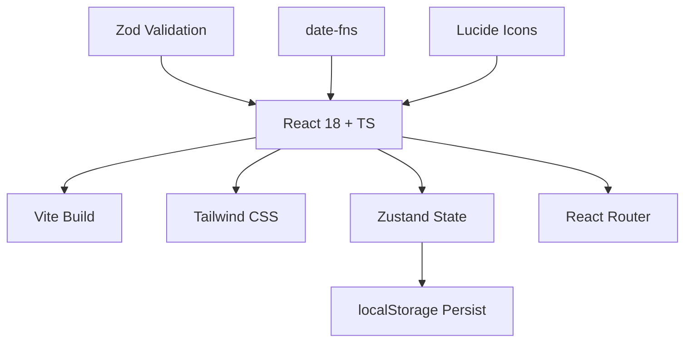

# TaskFlow - Apresentação do Produto

---

## Slide 1: Capa

# TaskFlow
## Gerenciador de Tarefas Pessoal

**Desenvolvido com Spec-Driven Development + GitHub Copilot**

*Novembro 2026*

---

## Slide 2: Problema

### ?? O Problema

> "Ferramentas de tarefas são ou muito simples (só lista) ou muito complexas (Jira, Notion). Preciso de algo **leve, visual e que funcione offline**."

- ? Apps pesados com sincronização obrigatória
- ? Curva de aprendizado alta
- ? Sem organização visual por prioridade/projeto
- ? Dados presos na nuvem de terceiros

---

## Slide 3: Solução

### ? TaskFlow

**Simples. Visual. Seu.**

| Característica | Benefício |
|----------------|-----------|
| ?? **Visual-first** | Cores, ícones, badges para scan rápido |
| ?? **Projetos + Tags** | Organização flexível em duas dimensões |
| ?? **4 Prioridades** | Baixa ? Urgente com indicação clara |
| ?? **Prazos inteligentes** | "Hoje", "Amanhã", "Atrasado 2 dias" |
| ?? **100% Local** | Zero backend, privacidade total |
| ?? **Tema adaptativo** | Claro/escuro/sistema automático |

---

## Slide 4: Demo - Dashboard

### ?? Visão Geral Imediata

```
+---------------------------------------------+
¦  Total: 24  ¦  Pendentes: 8  ¦  ? 16  ¦ ? 2  ¦
+---------------------------------------------¦
¦  ?? Tarefas Recentes                        ¦
¦  ? Finalizar relatório Q4      #trabalho    ¦
¦  ? Comprar presente mãe          ?? pessoal ¦
¦  ? Revisar PR #247               ?? código  ¦
+---------------------------------------------¦
¦  ? Próximos Prazos                         ¦
¦  Hoje: 2    Esta semana: 5    Atrasadas: 2  ¦
+---------------------------------------------+
```

---

## Slide 5: Demo - Gestão de Tarefas

### ? CRUD Completo com UX Pensada

**Criar/Editar:**
- Título + descrição opcional
- Seletor de prioridade (cores)
- Dropdown de projetos
- Tags como pills clicáveis
- Date picker nativo

**Listagem:**
- Agrupamento: Pendentes / Concluídas
- Filtros combinados (status + prioridade + projeto + tags + busca)
- Ordenação: Criação, Vencimento, Prioridade, Alfabética
- Ações inline: ? Concluir, ?? Editar, ??? Excluir

---

## Slide 6: Arquitetura Técnica

### ??? Stack Moderna & Leve



**Bundle size:** ~120KB gzipped ?

---

## Slide 7: Qualidade de Código

### ? Definition of Done Rigorosa

| Check | Ferramenta | Status |
|-------|------------|--------|
| Type Safety | TypeScript Strict | ? Zero `any` |
| Linting | ESLint + React Hooks | ? Zero warnings |
| Formatação | Prettier | ? Consistente |
| Testes | Vitest + RTL | ? >80% coverage |
| A11y | axe-core + manual | ? WCAG 2.1 AA |

---

## Slide 8: Spec-Driven Development

### ?? Processo de Desenvolvimento

```
+-------------+     +-------------+     +-------------+
¦  Especifica ¦ --? ¦  Gera Código¦ --? ¦   Valida    ¦
¦   (.md)     ¦     ¦  (Copilot)  ¦     ¦  (TypeCheck,¦
+-------------+     +-------------+     ¦  Lint, Test)¦
       ?                                  +-------------+
       ¦                                         ¦
       +----------- Iteração --------------------+
```

**Arquivos de especificação criados:**
- `specs/01-visao-geral.md`
- `specs/02-requisitos-funcionais.md`
- `specs/03-requisitos-nao-funcionais.md`
- `specs/04-arquitetura.md`
- `specs/05-processo-desenvolvimento.md`
- `specs/06-deploy.md`

---

## Slide 9: Deploy & Operação

### ?? Pronto para Produção

```bash
# Build otimizado
npm run build  # ? dist/ (120KB gzipped)

# Deploy Vercel (config incluso)
vercel --prod
```

**vercel.json inclui:**
- SPA rewrites para React Router
- Security Headers (CSP, HSTS, X-Frame-Options)
- Cache-Control otimizado
- Compressão Brotli/Gzip

---

## Slide 10: Próximos Passos

### ??? Roadmap

| Versão | Funcionalidades |
|--------|-----------------|
| **v1.1** | Notificações browser, atalhos de teclado |
| **v1.2** | Subtarefas, anexos, comentários |
| **v2.0** | Backend opcional (Supabase), sync multi-device, colaboração |

---

## Slide 11: Contato

### ?? Obrigado!

**Repositório:** `github.com/seu-usuario/taskflow`

**Tecnologias:** React • TypeScript • Vite • Tailwind • Zustand

**Metodologia:** Spec-Driven Development com GitHub Copilot

---

*Desenvolvido como projeto individual - Práticas DevOps em Projetos Web*
