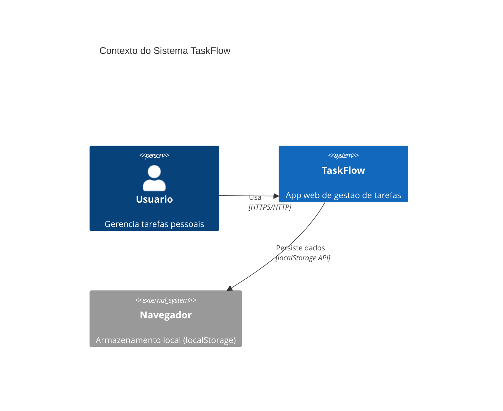
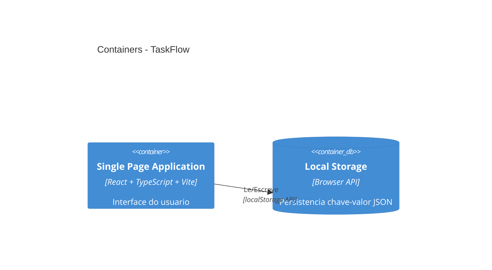

# Arquitetura e Design

## Diagrama de Contexto (C4 - Nível 1)



## Diagrama de Containers (C4 - Nível 2)



## Estrutura de Pastas (Feature-Based)

```
src/
+-- app/                    # Configuracao da aplicacao
¦   +-- providers/         # Providers (Theme, Store, Router)
¦   +-- routes/            # Definicao de rotas
+-- features/              # Funcionalidades (domain-driven)
¦   +-- tasks/             # Feature: Tarefas
¦   ¦   +-- components/    # Componentes especificos
¦   ¦   +-- hooks/         # Hooks customizados
¦   ¦   +-- store/         # Estado (Zustand slice)
¦   ¦   +-- types/         # Types TypeScript
¦   ¦   +-- utils/         # Utilitarios da feature
¦   +-- projects/          # Feature: Projetos
¦   +-- tags/              # Feature: Tags
+-- shared/                # Codigo compartilhado
¦   +-- components/        # UI components genericos (Button, Input, Modal...)
¦   +-- hooks/             # Hooks genericos (useLocalStorage, useDebounce...)
¦   +-- utils/             # Utilitarios gerais (date, validation, constants)
¦   +-- types/             # Types globais
+-- styles/                # Estilos globais (Tailwind, CSS variables)
+-- main.tsx               # Entry point
```

## Modelo de Dados (TypeScript)

```typescript
// shared/types/index.ts
export type Priority = "low" | "medium" | "high" | "urgent";
export type TaskStatus = "pending" | "completed";

export interface Tag {
  id: string;
  name: string;
  color: string; // hex
}

export interface Project {
  id: string;
  name: string;
  color: string; // hex
  icon: string;  // lucide icon name
  createdAt: string; // ISO 8601
}

export interface Task {
  id: string;
  title: string;
  description: string;
  status: TaskStatus;
  priority: Priority;
  projectId: string | null;
  tagIds: string[];
  dueDate: string | null; // ISO 8601 date only
  createdAt: string; // ISO 8601
  updatedAt: string; // ISO 8601
  completedAt: string | null;
}

export interface AppState {
  tasks: Task[];
  projects: Project[];
  tags: Tag[];
  theme: "light" | "dark" | "system";
}
```

## Fluxo de Dados (Unidirecional - Zustand)

```
User Action -> Component -> Hook/Action -> Store (Zustand) -> Persist Middleware -> localStorage
                                    |
                              Re-render Component <- State Change <- Subscribe
```

## Convenções de Código

- **Componentes**: PascalCase, arquivo `ComponentName.tsx`
- **Hooks**: camelCase com prefixo `use`, arquivo `useHookName.ts`
- **Types/Interfaces**: PascalCase, sufixo `Type` ou `Interface` opcional
- **Constantes**: UPPER_SNAKE_CASE
- **Arquivos de teste**: `*.test.tsx` ou `*.spec.tsx` junto ao arquivo testado
